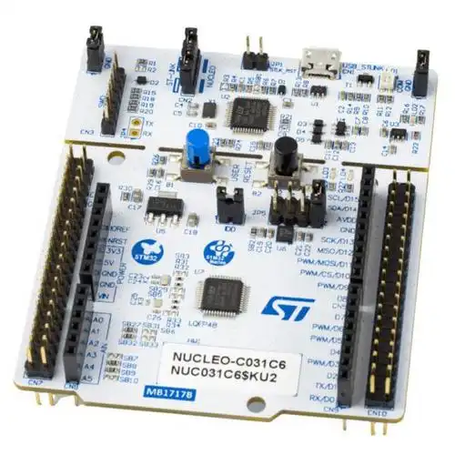

> **NOTE**
This file is best viewed in a **markdown viewer**, such as the one built into
GitHub. Markdown viewers are also available as plug-ins to popular Internet browsers.

# DPP on NUCLEO-C031C6 with FreeRTOS
This example demonstrates the QP/C port to FreeRTOS on the STM32 NUCLEO-C031C6
board (ARM Cortex-M0+).

<p align="center">

</p>

The example uses the [Dining Philosophers Problem (DPP) application](https://www.state-machine.com/qpc/tut_dpp.html)

<p align="center">
<br>
<b>STM32 NUCLEO-C031C6 (Cortex-M0+)</b>
</p>

## Features Demonstrated
- QP/C port to FreeRTOS
  + with GNU-ARM toolchain
  + with Keil-MDK toolchain
  + with IAR-ARM toolchain
  + with CMake (GNU-ARM and Keil-MDK)
- multiple cooperating active objects
- immutable (const) events
- mutable (dynamic) events
- time events
- direct event posting
- publish-subscribe event delivery


## Build Configurations
- Debug
- Release
- Spy - software tracing with the built-in virtual COM port

# Code Organization
```
examples\freertos\arm-cm\dpp_nucleo-c031c6
|   |   CMakeLists.txt        // CMake project
|   |   CMakePresets.json     // CMake presets
|   |
|   +---armclang              // Keil-MDK toolchain
|   |       . . .
|   |       dpp.uvprojx       // Keil uVision project
|   +---gnu                   // GNU-ARM toolchain
|   |       . . .
|   |       Makefile          // Makefile for GNU-ARM
|   \---iar                   // IAR EWARM
|           . . .
|           dpp.eww           // IAR EW-ARM workspace
```

# Building the example

### GNU/ARM
- open terminal window
- change to the directory `examples\freertos\arm-cm\dpp_nucleo-c031c6\gnu`
- to build the default Debug configuration, type:

```
make
```

> **NOTE**
The `make` utility for Windows is provided in the QTools collection for Windows.

- to build the Release configuration, type:

```
make CONF=rel
```

- to build the Spy configuration, type:

```
make CONF=spy
```

### ARM/KEIL MDK
- Open the provided KEIL uVision project (`armclang\dpp.uvprojx`)
in Keil uVision IDE. Build/Debug/Download to the board from the IDE.
- Change the build configuration in the "Project Target" drop-down menu.


### IAR EWARM
- Open the provided IAR EWARM workspace (`iar\dpp.eww`)
in IAR EWARM IDE. Build/Debug/Download to the board from the IDE.
- Change the build configuration in the "Project Configuration" drop-down menu.


### CMake
- open terminal window
- change to the directory `examples\freertos\arm-cm\dpp_nucleo-c031c6`
- configure with the preset `freertos-gnu` (GNU-ARM) or `freertos-armclang` (Keil-MDK)
and build the Debug, Release, or Spy configuration, for example:

```
cmake --preset freertos-gnu
cmake --build --preset freertos-gnu
cmake --build --preset freertos-gnu --config Release
cmake --build --preset freertos-gnu --config Spy
```

The results are in `Build\<preset>\<config>` (e.g., `Build\freertos-gnu\Debug\dpp.bin`).
Please see the [CMake Support](https://www.state-machine.com/qpc/gs_cmake.html)
section in the QP/C manual for details.


# Uploading the Binary to the Board
The STM32 NUCLEO boards enumerate as a USB drive when connected to the host
computer. The boards then can be programmed by **copying** the binary to that
USB drive. This can be useful for the command-line GNU/ARM build. For example,
to program the binary produced for the Debug configuration, you can type:

```
copy dbg\dpp.bin E:
```
NOTE: The above command assumes that the NUCLEO board enumerated as drive E:.
Of course you need to adjust the command for your specific drive letter.

Alternatively, if you use IDEs, such as KEIL-MDK or IAR EWARM, you can
program the board from the IDE (e.g., by starting a debug session).


# Tracing with QP/Spy
When the board is flashed with the Spy build configuration, it produces the
QP/Spy software tracing output to the built-in virtual COM port of the NUCLEO board.
The trace is binary rather than ASCII, and therefore requires a special host-based
application called QSPY.

> **NOTE** QSPY host application is available in the QTools collection.

To launch the QSPY host application:
- open command-prompt window
- type:

```
qspy -c COM5
```

where "COM5" is an example virtual COM port enumerated by the board. You need to
check the specific COM port number on your host computer using the Device Manager
application, Ports (COM and LPT) section.


The following screen shot shows a typical output from QSPY:

<p align="center">
<br>
<b>Typical QSPY output produced by the Spy build configuration</b>
</p>
